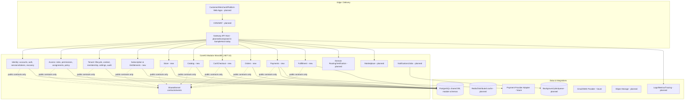
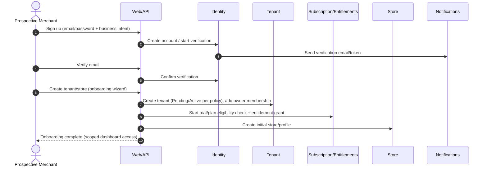
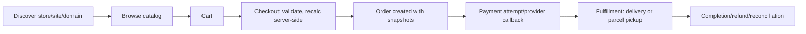
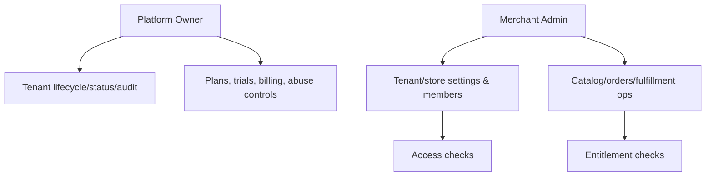
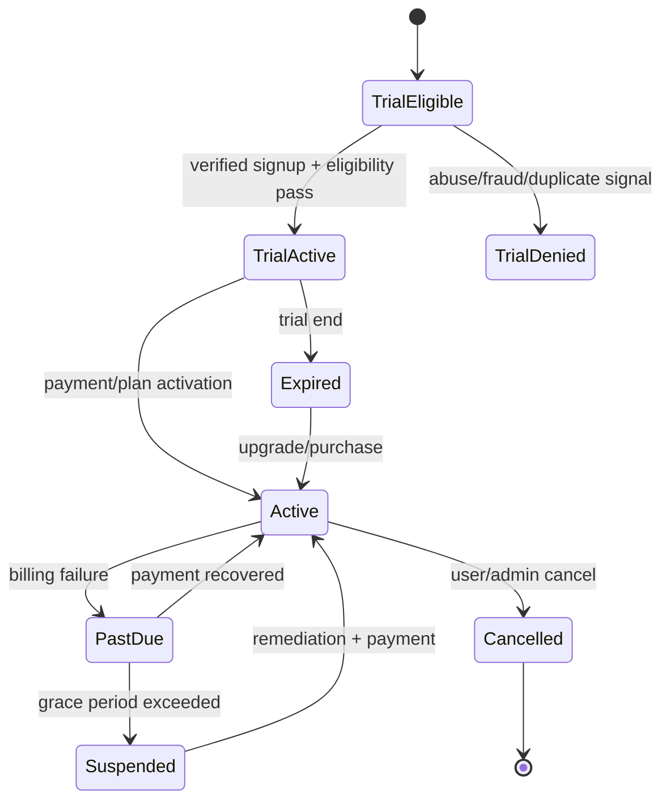

# DK-APP-MASTER-PLAN-01 — Whole Application Architecture and Product Design (Read-Only)

## 0. Baseline and inspection scope
- **Repository / root:** `F:\Developer\waqas-dba\waqas-dba\Dastarkhwan` (git repo: yes)
- **Branch:** `master`
- **Exact HEAD inspected:** `815b5cda0b8429079c2295f415f95ee27de451b9`
- **HEAD date/subject:** `2026-11-10 18:15:07 +0500` — `feat(tenant): enforce current tenant membership on scoped requests`
- **Local working tree:** clean (`git status --short` empty) at inspection time
- **Baseline match:** local HEAD matches supplied GitHub baseline (`815b5cda...`). No discrepancy reported.
- **Inspected (read-only):** solution `Dastarkhwan.slnx`; project refs and source under `CoreKit.SharedKernel/`, `CoreKit.Identity/`, `CoreKit.Access/`, `CoreKit.Tenant/`, `CoreKit.SampleHost/`; `CLAUDE.md`, `AGENTS.md`, `ai-tasks.md`, `architecture.md`, `roadmap.md`, `current-state.md`, `decisions.md`; selected tests/projects inventory only (no test/build execution). No files modified; no migrations; no Git writes.

## 1. Executive summary
Dastarkhwan/CoreKit is a .NET 10 modular-monolith foundation (Identity, Access, Tenant, SharedKernel) with PostgreSQL-oriented persistence, endpoint mapping, and sample composition. Core auth/RBAC/tenant primitives exist but are **incomplete and partially inconsistent with approved/docs target** (notably Access/Identity ownership transition, Tenant/Identity decoupling status in docs vs code, and unresolved product decisions). The platform is **not yet** a self-service SaaS business application (no Store, Catalog, Cart, Orders, Payments, Fulfillment, Subscription, Marketplace, website, custom-domain, billing provider, or operational stack implemented).

**Key conflicts/gaps (source vs docs/decisions):**
- `docs/current-state.md` snapshot is stale (`576c84d...`) vs inspected HEAD `815b5cda...`; several statuses may lag.
- `docs/current-state.md` and `docs/architecture.md` state `CoreKit.Tenant` still directly references `CoreKit.Identity` (D-015 incomplete), but `CoreKit.Tenant/CoreKit.Tenant.csproj` references only `CoreKit.SharedKernel` (verified). Tenant source inspected uses SharedKernel/tenant-local abstractions (`ITenantMembershipReader`, `ICurrentTenant` integration points present).
- `CoreKit.Identity/Persistence/IdentityDbContext.cs` still owns `Roles`, `Permissions`, `UserRoles`, `RolePermissions` tables/entities while `CoreKit.Access` has its own role/assignment/permission model (`CoreKit.Access/Persistence/AccessDbContext.cs`, `Entities/AccessEntities.cs` implied). D-002 ownership transfer remains unresolved/incomplete in implementation.
- Self-service onboarding, trials, subscriptions/entitlements, marketplace, custom domains, payments, and production ops are planned/new proposals only.

No capacity claims are made; no tests/builds/benchmarks were executed.

## 2. Whole-application architecture (target, modular monolith first)

## 3. Component status classification (implemented / incomplete / planned / new)

| Component | Status | Evidence (source paths/lines or docs) | Notes |
|---|---|---|---|
| SharedKernel contracts (`ICurrentUser`, `ICurrentTenant`, `ITenantMembershipReader`, `IAccessTokenClaimsContributor`, permission primitives) | **Implemented (foundation, limited scope)** | `CoreKit.SharedKernel/Abstractions/ICurrentTenant.cs:1-33`, `ITenantMembershipReader.cs:1-16`, `IAccessTokenClaimsContributor.cs:1-22`, `ICurrentUser.cs` (listed) | Small cross-module surface exists; sufficient as seed, not proof of full decoupling adoption. |
| Identity (auth, users, roles/permissions-in-Identity, email verification, seeding, endpoints) | **Present but incomplete / transitional** | `CoreKit.Identity/Services/AuthService.cs:1-220+` (login/refresh/logout/change-password flows, lockout handling present), `UserService.cs:1-520` (permission checks enforced), `RoleService.cs:1-260` (permission checks + Administrator protections), `PermissionService.cs:1-52`, `Endpoints/IdentityEndpointExtensions.cs:1-320` (route-level `RequirePermission`), `Persistence/IdentityDbContext.cs:1-35` (owns Users/Roles/Permissions/RefreshTokens/etc.) | Owns RBAC tables contrary to D-002 target; lockout behavior exists in code path but completeness/verification not established. |
| Access module (scoped roles/assignments/audit/maintenance, own schema/endpoints) | **Present but incomplete** | `CoreKit.Access/Persistence/AccessDbContext.cs:1-74` (`ACCESS_*` tables), `Endpoints/AccessEndpointExtensions.cs:1-88`, `CoreKit.Access/CoreKit.Access.csproj` (refs EF/Npgsql, `InternalsVisibleTo CoreKit.Access.Tests`), migrations present `CoreKit.Access/Migrations/*` | Parallel authorization model vs Identity roles/permissions; ownership migration (D-002) unresolved. |
| Tenant module (registry, members/settings/audit, resolution middleware, status enforcement, endpoints) | **Implemented core, with security gap** | `CoreKit.Tenant/Persistence/TenantDbContext.cs:1-86` (`TENANT_*`), `Resolution/TenantResolutionMiddleware.cs:1-126` (tenant resolution + membership validation for authenticated parseable user IDs), `Endpoints/TenantEndpointExtensions.cs:1-170`, `Integration/TenantClaimsContributor.cs:1-30`, `CoreKit.Tenant/CoreKit.Tenant.csproj` (refs SharedKernel only) | **Gap:** authenticated user with missing/malformed user ID skips membership validation and request proceeds (`TenantResolutionMiddleware.cs:101-117`, `GetUserId` :119-125). |
| SampleHost composition | **Implemented (demo/dev host)** | `CoreKit.SampleHost/Program.cs:1-78` wires Identity/Tenant/Access, migrates DBs on startup (dev convenience), seeds Identity, maps demo endpoints; dev-only token endpoint `:69-74` | Not production host; startup auto-migrate inappropriate for prod. |
| Tests/projects | **Present but incomplete (inspection only)** | Solution includes `CoreKit.Identity.Tests`, `CoreKit.Access.Tests`, `CoreKit.Tenant.Tests`, `CoreKit.Architecture.Tests` (`Dastarkhwan.slnx:15-23`) | Existence only; execution/results not verified. |
| Store, Catalog, Cart, Checkout, Orders, Payments, Fulfillment, Marketplace, Website/UI, Domain routing ops, Subscription module | **New proposal (not implemented)** | No corresponding projects/modules in solution; roadmap marks M6–M14 pending/in progress dependencies (`roadmap.md`) | Must be designed via contracts and module boundaries before creation. |
| Custom domains, background processing, caching, observability, backup/recovery automation, AI agent service | **Planned/New proposal** | Mentioned in docs/requirements; no implementation evidence | Future/operational capabilities. |

## 4. Module responsibility and dependency matrix

| Module / Area | Responsibility (approved/target) | Must not own | Current dependency evidence | Status vs target |
|---|---|---|---|---|
| **SharedKernel** | Minimal stable contracts/events/primitives (`ICurrentUser`, `ICurrentTenant`, membership/claims/permission contracts) | Business workflows, module persistence, dumping-ground types | `CoreKit.SharedKernel/CoreKit.SharedKernel.csproj` has no project refs | **Implemented (seed)**; keep small |
| **Identity** | Accounts, credentials, authentication, sessions/tokens, lockout/recovery, identity lifecycle | Business authorization policy/roles-permissions ownership (post D-002 target) | `CoreKit.Identity.csproj` refs `SharedKernel`; DbContext owns role/permission tables | **Incomplete/transitional**; D-002 not complete |
| **Access** | Roles, permissions, assignments, scoped authorization checks, audit for access decisions | Credentials, Identity private persistence | `CoreKit.Access.csproj` no project refs shown; uses SharedKernel-style ports/contracts in codebase | **Present but incomplete**; dual model with Identity RBAC |
| **Tenant** | Tenant lifecycle/status, resolution/context, membership, settings, tenant audit; fail-closed tenant boundary | Identity implementation, Store/Catalog/Order logic | `CoreKit.Tenant.csproj` refs `SharedKernel` only; middleware uses `ITenantMembershipReader` | **Core implemented**; membership bypass on malformed authenticated ID is unresolved |
| **Store** (new) | Merchant/store profile, ownership, settings/branding, status, store-level config | Catalog pricing rules internals, orders/payments settlement | N/A | **New proposal** |
| **Catalog** (new) | Products/categories/availability/pricing definitions | Checkout totals/payment state/order history mutation | N/A | **New proposal** |
| **Cart/Checkout** (new) | Cart state, server-side validation/recalculation, checkout orchestration | Payment settlement/funds capture | N/A | **New proposal** |
| **Orders** (new) | Order lifecycle, line items, immutable snapshots (price/currency/tax/fees/discounts) | Provider internals, fulfillment execution | N/A | **New proposal** |
| **Payments** (new) | Payment intents/attempts/state, provider adapters, callbacks/idempotency/reconciliation | Catalog/store management | N/A | **New proposal** |
| **Fulfillment** (new) | Delivery/pickup tasks, assignment, state transitions | Payment settlement/pricing authority | N/A | **New proposal** |
| **Subscription** (new, M6) | Plans, trials, lifecycle, entitlements/limits, tenant billing records (separate from order payments) | Identity/Access/Tenant internals, order payments | N/A | **New proposal** |
| **Domain routing** (planned) | Verified hostname -> tenant/site/store mapping, HTTPS/domain lifecycle hooks | Authorization, membership | N/A | **Planned** |
| **Marketplace/Website/API hosts** | Composition, thin endpoints/UI, discovery views | Duplicated business rules/private persistence | SampleHost is demo composition | **Planned/New** |

**Dependency rules to preserve:** no module-to-module private DbContext/table access; no circular deps; Tenant/Store standalone boundaries respected; hostname never authorization.

## 5. User journey diagrams

### 5.1 Self-service registration, verification, tenant/store onboarding (target)

**Current evidence:** Identity has registration/login/verification primitives (`AuthService`, `IEmailVerificationService`, endpoint mappings in `IdentityEndpointExtensions.cs`); Tenant supports tenant/member/settings APIs (`TenantEndpointExtensions.cs:1-170`); no automated self-service tenant/store creation workflow, no trial/entitlement engine, no Store module.

### 5.2 Customer purchase journey (target)

**Current evidence:** none of Catalog/Cart/Orders/Payments/Fulfillment implemented.

### 5.3 Platform owner / merchant administration (target)

**Current evidence:** Tenant admin/member/audit endpoints exist (`TenantEndpointExtensions.cs`); Access role/assignment endpoints exist (`AccessEndpointExtensions.cs`); no platform-owner SaaS control plane, no subscription admin, no store/ops UIs.

## 6. Proposed database ownership map

| Schema/Table prefix (observed/proposed) | Owning module | Key entities (evidence/proposal) | Tenant scoping |
|---|---|---|---|
| `Identity`-owned tables (no explicit prefix in code shown): `Users`, `Roles`, `Permissions`, `UserRoles`, `RolePermissions`, `RefreshTokens`, `EmailVerificationTokens` | **Identity (current)**; target split per D-002 | `IdentityDbContext.cs:20-33` | Global identity data (not tenant-row scoped by design); access to tenant operations must still be membership/authorization gated |
| `ACCESS_*`: `Roles`, `RolePermissions`, `Assignments`, `AuditEntries` | **Access** | `AccessDbContext.cs:20-74` | Scope-based (`ScopeType`, `ScopeId`) supports tenant/store/platform scoping; must be enforced in services/authz |
| `TENANT_*`: `Tenants`, `Settings`, `Members`, `AuditEntries` | **Tenant** | `TenantDbContext.cs:20-86` | Platform registry; tenant boundary enforced in services/middleware, not by tenant row filter on all tables |
| `SUBSCRIPTION_*` (proposed) | **Subscription** | Plans, TenantSubscriptions, Entitlements, Usage, BillingRecords, Events | Tenant-owned records require explicit `TenantId`, constraints/indexes, fail-closed resolution |
| `STORE_*` / `CATALOG_*` / `ORDER_*` / `PAYMENT_*` / `FULFILLMENT_*` (proposed) | Store/Catalog/Orders/Payments/Fulfillment respectively | Store, Product, Category, Cart/Checkout artifacts, Order/OrderLine snapshots, PaymentAttempt, DeliveryTask etc. | Tenant + Store ownership keys as applicable; immutable order/payment snapshots; idempotency keys for callbacks/jobs |
| `DOMAIN_*` (proposed) | Domain routing | Hostname, verification tokens/state, cert/provisioning metadata refs | Tenant/store mapping with uniqueness/conflict controls; hostname not auth |

**Notes:** Shared PostgreSQL DB, module-owned schemas/tables (approved). Global query filters are defense-in-depth only; services/authz/jobs/callbacks must enforce scope (D-011, `architecture.md`).

## 7. API and UI application structure

| Surface | Current state | Proposed structure |
|---|---|---|
| **Identity API** | Mapped under `/Identity` (`MapIdentity`, `IdentityEndpointExtensions.cs:15-31`) with auth/users/roles/permissions groups | Keep thin; align with D-002 ownership split; add secure recovery/rate limits/observability hooks |
| **Tenant API** | Mapped under `/tenants` (`TenantEndpointExtensions.cs:16-34`) incl. `/current`, `/me`, settings/members/audit, lifecycle actions | Add self-service onboarding endpoints/workflows with eligibility, fraud controls, and entitlement checks |
| **Access API** | Mapped under `/access` (`AccessEndpointExtensions.cs:14-66`) for me/permissions/roles/assignments/audit | Converge with final RBAC ownership model; enforce scope consistently |
| **SampleHost** | Minimal host + demo routes (`Program.cs:59-75`) | Replace/supplement with production Gateway host composing modules via public contracts |
| **Customer storefront** | Not implemented | Separate web app (tech TBD, D-014/open decision) consuming public APIs; market/currency/domain-aware |
| **Merchant admin** | Not implemented | Web app for store/catalog/orders/fulfillment/subscription management |
| **Platform owner console** | Not implemented | Tenant lifecycle, plans/billing, abuse/fraud review, support operations, audit views |
| **Public/marketplace API** | Not implemented | Paginated discovery filtered by visibility/market/availability; no private data leakage |

## 8. Security threat/control matrix

| Threat / risk | Likelihood/impact (design) | Current evidence/control | Gap / required control | Status |
|---|---|---|---|---|
| Cross-tenant data access / tenant spoofing | High/Critical | `TenantResolutionMiddleware` resolves tenant, rejects unknown/mismatch/inactive, checks membership for authenticated parseable IDs (`TenantResolutionMiddleware.cs:49-114`); `TENANT_*` isolated registry | **Fix required:** authenticated + tenant resolved but missing/malformed user ID currently bypasses membership check (`:101-117`) — fail-open; ensure all tenant-scoped reads/writes/jobs/exports enforce scope and ownership | **Unresolved defect risk** |
| Privilege escalation / broken RBAC | High/High | Permission checks in `UserService`, `RoleService`, `PermissionService`; route-level `RequirePermission`; admin-role protections (e.g. grant/change restrictions) | D-002 dual RBAC models (Identity + Access) increase confusion/inconsistency risk; need single authoritative ownership and audited enforcement paths | **Incomplete** |
| Credential/session abuse, token replay/reuse | Med-High/High | Refresh-token flows, revocation-on-reuse logic indicated in `AuthService.cs` (reviewed partially), lockout handling, no plaintext token intent implied | Verify rotation atomicity, reuse detection, revocation, storage hashing, token claim integrity, device/session management; rate limiting coverage beyond auth group | **Under review** |
| Account enumeration / verification abuse | Med/Med | Generic login failure behavior in `AuthService` (timing mitigation attempt `:104-109`) | Ensure consistent responses/timing for login/reset/verify/resend; bot protection and throttling for signup/verification flows | **Partial/New controls needed** |
| Fake registrations, trial abuse, bots | High/Med-High (SaaS) | None implemented | CAPTCHA/risk scoring, email/phone verification, device/IP heuristics, payment-method checks where appropriate, one-trial-per-entity policy, manual review queues, rate limits | **New proposal (required for self-service)** |
| Payment fraud / callback forgery / duplicate processing | High/High (future) | No payments implemented | Provider signature validation, idempotency keys, server-side amount/currency verification, reconciliation, refund/chargeback workflows | **New proposal** |
| Unsafe custom-domain routing / takeover | Med/High | No domain module | DNS ownership verification, strict hostname normalization, certificate lifecycle, conflict/unknown-host fail-closed, tenant binding checks | **Planned/New** |
| Injection / insecure deserialization / mass assignment | Med/High | EF parameterization typical; server-side services used | Input validation at boundaries, DTO allowlists, output encoding in web, safe error handling, dependency/security scanning | **Ongoing requirement** |
| Resource exhaustion / unbounded queries | Med/Med | Pagination in some services (e.g. users list clamps page size) | Enforce bounded pagination/projections everywhere, timeouts, queue limits, per-tenant quotas/entitlements | **Partial/New** |
| Secrets/config exposure | Med/High | Repo docs warn; no active secret values inspected | Secret manager/env config, rotation, audit of history exposure (carried forward unknown in `current-state.md`) | **Operational follow-up** |

## 9. Performance and hosting strategy (low-cost, measured)

| Concern | Recommendation | Rationale |
|---|---|---|
| **Baseline hosting** | Single-region managed PostgreSQL + 1-2 app instances (container/App Service/VM) behind managed TLS/LB; object storage for assets | Fits modular monolith and low initial cost; scale vertically first |
| **Scale path** | Add read replicas/caching/queue workers only when metrics justify; keep monolith deployable; split services only on measured bottlenecks/ownership needs | Avoid premature microservices/cost |
| **Database** | Proper indexes per query patterns, bounded pagination, projections, short transactions, no N+1; tenant/store-safe keys; connection pooling | PostgreSQL efficiency at modest cost |
| **Caching** | Cache read-heavy public/catalog/config data with tenant/store/domain-aware keys and explicit invalidation; no caching of authz decisions without strict invalidation | Reduce DB load safely |
| **Background processing** | Queue for email, domain verification, billing sync, reports, notifications, AI jobs (future) with retries/idempotency and dead-letter handling | Keep request latency low |
| **Capacity claims** | **No claim of “thousands of simultaneous users”** without load tests, workload model, and SLO/error-budget evidence | Required by task; current evidence absent |

## 10. Subscription, trial, and self-service workflow (integrated target)

| Aspect | Target design | Status |
|---|---|---|
| Plan/entitlement model | Plans define features, limits (stores, products, orders, staff, domains, API/AI credits), and market pricing; enforced server-side per request/job | **New proposal** |
| Trial lifecycle | Eligibility rules, duration, conversion/expiry handling, anti-abuse checks, audit trail | **New proposal** |
| Billing separation | Tenant subscription billing separate from customer order payments (D/M6 intent in roadmap) | **New proposal** |
| Enforcement points | Tenant/store creation, publish/catalog size, checkout/order volume, premium features, custom domain, AI usage | **New proposal** |
| Integration | `CoreKit.Subscription` module via public contracts; no private cross-module DB access | **New proposal** |

## 11. Future AI Agent-as-a-Service (optional, isolated)

| Boundary | Design rule |
|---|---|
| Product dependency | **Not an MVP/core dependency**; core ordering/fulfillment/billing must operate without AI |
| Packaging | Separate module/service boundary (e.g. `CoreKit.AI` or external worker) behind explicit contracts, quotas, and billing/entitlement checks |
| Security/isolation | Tenant-scoped data access only through approved APIs/contracts; prompt/input/output logging with redaction; per-tenant rate/credit limits; no direct DB access to other modules |
| Cost control | Async jobs, budget caps, model/provider abstraction, usage metering tied to subscription entitlements |
| Failure mode | Graceful degradation to manual workflows; no AI path can bypass authz/tenant checks |

## 12. Recommended roadmap and milestone dependencies

| Phase | Milestone / focus | Depends on | Exit evidence (target) |
|---|---|---|---|
| **Foundation hardening** | Resolve D-002 ownership split plan/implementation, complete D-015 verification/decoupling as needed, fix TenantResolution membership fail-open for malformed authenticated ID, review/apply-safe migration strategy | Current HEAD, approved decisions | Reviewed code, focused tests, independent security review, no cross-module private access |
| **SaaS onboarding core** | Self-service signup/verification hardening, tenant+initial store provisioning workflow, platform/merchant admin basics | Identity + Tenant + Access stable contracts | End-to-end onboarding flow, auditability, fail-closed scoping |
| **M6 Subscription** | Plans, trials, lifecycle, entitlements, billing records, enforcement hooks (provider decision later/adapter-based) | Tenant/Store foundations, policy decisions | Server-side entitlement enforcement + tests |
| **Commerce core** | Store + Catalog + Cart/Checkout + Orders | M5/M6 decisions, Store model | Server-side pricing/snapshot correctness, scoped APIs |
| **Payments & Fulfillment** | Payment adapters/callbacks/idempotency + delivery/parcel workflows | Orders, provider/pricing decisions | Reconciliation/idempotency/race safety, state machines tested |
| **Routing & Web** | Domain verification/routing, customer/merchant/platform UIs | Stable APIs, D-014 decisions | Hostname fail-closed, verified domain flows, authz preserved |
| **Marketplace & Ops** | Discovery, notifications/jobs, observability, backups/DR, performance tuning | Prior modules stable | SLO-oriented metrics, recovery drills, no data leakage |
| **Optional AI** | Metered AI assistants/automation | Entitlements, ops, data governance | Isolated, quota-enforced, non-core dependency |

## 13. Open decisions and risks (must not be silently resolved)

| ID/Area | Open decision / risk | Why it matters | Owner |
|---|---|---|---|
| **D-002 impl** | How/when to complete Identity→Access role/permission ownership transfer and data migration | Security model consistency, dual-source-of-truth risk | Project Owner + architecture |
| **D-009** | Single-store vs multi-store checkout | Order ownership, fees, payments, refunds, fulfillment | Project Owner |
| **D-010** | Parcel pickup initiation/lifecycle/assignment/cancellation | Fulfillment model and UX/API contracts | Project Owner |
| **D-013** | Initial payment methods, COD behavior, provider selection | Compliance, integration, idempotency/reconciliation | Project Owner |
| **D-014** | Website technology, custom-domain verification, HTTPS/DNS operations | Delivery architecture and ops complexity/cost | Project Owner |
| **Subscription product** | Trial duration/eligibility, plan tiers, limits, pricing, grace periods, premium entitlements | Abuse prevention and revenue/enforcement correctness | Project Owner |
| **Store model** | Single-store vs multi-store per tenant (and implications) | Data model, UX, permissions, routing | Project Owner |
| **Doc/source drift** | `current-state.md` snapshot stale; Tenant→Identity dependency described differently than csproj | Misleading planning/review baseline | Project Owner (docs sync task) |
| **Security** | Malformed authenticated user ID bypass in `TenantResolutionMiddleware` | Tenant boundary bypass risk | Project Owner (approve fix task) |
| **Secrets history** | Possible historical secret exposure follow-up status unknown | Credential compromise risk | Project Owner/ops |
| **Performance** | No measured benchmarks/load tests | Hosting/capacity decisions remain assumptions | Project Owner (when needed) |

## 14. Conflicts between actual source, approved decisions, and documentation

| Conflict | Evidence |
|---|---|
| **Tenant→Identity dependency (D-015/docs vs source)** | `architecture.md` / `current-state.md` / `roadmap.md` state Tenant still references Identity; `CoreKit.Tenant/CoreKit.Tenant.csproj` shows only `ProjectReference` to `CoreKit.SharedKernel` (no Identity ref). Requires verification of runtime/contracts and doc correction if accurate. |
| **RBAC ownership (D-002 accepted vs implementation)** | `decisions.md` D-002: Access owns roles/permissions/assignments; `CoreKit.Identity/Persistence/IdentityDbContext.cs:20-33` still defines `Roles/Permissions/UserRoles/RolePermissions`; `CoreKit.Access` maintains separate `ACCESS_*` model (`AccessDbContext.cs:20-74`). |
| **Current snapshot/document freshness** | `current-state.md` records snapshot HEAD `576c84d...`; inspected HEAD is `815b5cda...` (ahead). |
| **Account lockout policy stated vs verified completeness** | D-012 and roadmap S5 reference 5 attempts/15 min; `AuthService.cs` contains lockout handling logic, but end-to-end verification/tests not run/confirmed here. |

## 15. Security, performance, and acceptance standards (for future approved work)
- **Security:** fail-closed tenant/authz checks; server-side entitlement/pricing validation; signed/idempotent payment callbacks; secret hygiene; audit of sensitive actions; least privilege; no hostname-as-authz.
- **Performance/cost:** measure before scaling claims; bounded queries/pagination; indexes from real patterns; async I/O; cache only with safe keys/invalidation; background jobs for slow/external work.
- **Acceptance:** source-verified changes, explicit scope, independent review for security/architecture, user-run/manual verification as authorized, documented migrations (no unapproved application), no Git writes by AI.

## 16. Exact source paths and line references (key evidence)
- `Dastarkhwan.slnx:15-23` — CoreKit projects in solution
- `CoreKit.SharedKernel/Abstractions/ICurrentTenant.cs:1-33` — tenant context contract
- `CoreKit.SharedKernel/Abstractions/ITenantMembershipReader.cs:1-16` — membership read contract
- `CoreKit.SharedKernel/Abstractions/IAccessTokenClaimsContributor.cs:1-22` — token claim extension contract
- `CoreKit.Identity/Persistence/IdentityDbContext.cs:20-33` — Identity-owned RBAC/session tables
- `CoreKit.Identity/Services/UserService.cs:77-520` — permission checks, admin protections, session revocation behaviors
- `CoreKit.Identity/Services/RoleService.cs:39-260` — permission checks, Administrator immutability, assignment constraints
- `CoreKit.Identity/Services/PermissionService.cs:25-52` — permission read checks
- `CoreKit.Identity/Services/AuthService.cs:1-220` — login/lockout/email-confirmation/refresh/logout flow (partial view)
- `CoreKit.Identity/Endpoints/IdentityEndpointExtensions.cs:15-320` — `/Identity` API mapping and permission guards
- `CoreKit.Access/Persistence/AccessDbContext.cs:20-74` — `ACCESS_*` schema, scoped roles/assignments/audit
- `CoreKit.Access/Endpoints/AccessEndpointExtensions.cs:14-88` — `/access` API mapping
- `CoreKit.Access/CoreKit.Access.csproj` — framework/EF deps, `InternalsVisibleTo CoreKit.Access.Tests`
- `CoreKit.Tenant/Persistence/TenantDbContext.cs:20-86` — `TENANT_*` schema
- `CoreKit.Tenant/Resolution/TenantResolutionMiddleware.cs:49-126` — resolution, status checks, membership validation and **bypass when user ID missing/malformed** (`:101-117`, `:119-125`)
- `CoreKit.Tenant/Endpoints/TenantEndpointExtensions.cs:16-170` — `/tenants` API mapping
- `CoreKit.Tenant/Integration/TenantClaimsContributor.cs:1-30` — tenant claim contribution
- `CoreKit.Tenant/CoreKit.Tenant.csproj` — references `CoreKit.SharedKernel` only (no Identity project reference)
- `CoreKit.SampleHost/Program.cs:1-78` — module composition, dev migrations/seeding, demo routes
- `docs/current-state.md`, `docs/architecture.md`, `docs/decisions.md`, `docs/roadmap.md` — approved target, recorded decisions/status (see conflicts above)

**Read-only compliance (original task):** No repository files were modified; no tests/builds/migrations were run; no Git write operations were executed during analysis. This document file was generated on explicit user request.
